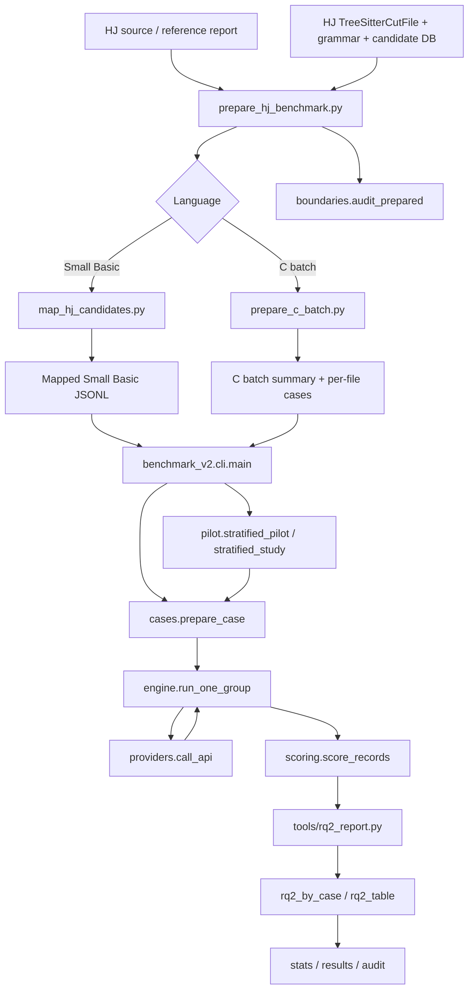

# Architecture and Function Map — Code Completion Lab

**Audience:** researchers maintaining the C / Microsoft Small Basic HJ-guided benchmark. **Scope:** current Python source modules and entrypoints. **Research protocol:** [`FINAL_FRAGMENT_PROTOCOL.md`](FINAL_FRAGMENT_PROTOCOL.md). **Getting started and complete commands:** [`../README.md`](../README.md). Historical scripts under [`archive/`](archive/) are intentionally excluded from the active dependency graph.

This guide is derived from the active implementation after the unified-engine / legacy cleanup. **A function's presence does not imply that the function is reached in every mode**: some are only for `--scope study`, optional C FIM, audit-only checks, or historical `--profile lab`. Names preceded by **CORE** are the key functions to trace while presenting the software to a supervisor.

## A. Architecture boundaries

| Layer | Responsible code | Input | Output | Calls an external service? |
| --- | --- | --- | --- | --- |
| HJ native parser/retrieval | External `$HOME/PL/.../TreeSitterCutFile{,.exe}`, grammar `.so`, candidate DB | Source bytes, cursor byte, language, mode | Parser states, candidate structures/frequencies | **Local native process**, no LLM API |
| Reference/cursor ingestion | `prepare_hj_benchmark.py` | HJ report JSON, source code, states/DB | `prepared.jsonl` + statuses/hash provenance | HJ local subprocess |
| C corpus batch | `prepare_c_batch.py` | C source/report pairs, HJ preparer | `summary.json`, per-file `prepared.jsonl` and `cases.jsonl` | HJ local subprocess |
| Small Basic token adaptation | `map_hj_candidates.py` | Raw SB JSONL, `token_mapping.json` | `cases_mapped.jsonl` | No |
| Cohort and condition assembly | `benchmark_v2.cli`, `.pilot`, `.cases`, `.prompts` | Eligible cases; frozen sampling flags | Nine tasks per case, `cohort.json`, prepared `cases.jsonl` | No |
| Paid model execution | `benchmark_v2.engine`, `.providers` | Task payloads, credentials | `responses.jsonl`, manifest | **Yes, paid provider API** (only generation stage) |
| Scoring and RQ2 reporting | `.scoring`, `tools/rq2_report.py` | Cases + model responses | Raw `scores.csv`, per-case summary, retrieval coverage, optional plots | No |
| Read-only interpretation | `benchmark_v2.__main__`, `.stats`, `.audit`, `.boundaries` | Saved reports/preparation | Tables, paired CI, provenance warnings | No |

### A.1 Data-flow and call graph

*Diagram note:* `prepare_c_batch.py` internally **calls** `prepare_hj_benchmark.py` as a subprocess for every C source/report pair; in the diagram, its C path represents that wrapper. The per-cursor rank/reference checks originate during raw HJ preparation. Graph edges are a conceptual flow, not a promise of every command being automatically chained.

### A.2 What the model can and cannot see

For `fragment-v1`, the generated prompt uses **prefix text + optionally one grammar structure**. The reference **completion text** is retained in `case['references']` **only for scoring**; `ideal_guidance` reveals the reference **grammar structure**, making it an explicitly privileged/oracle diagnostic. C optional infill uses the reference **end byte** to construct a suffix and is therefore outside the prefix-only frozen study.

## B. User-facing scripts and full function inventory

### B.1 `run_c.py` and `run_smallbasic.py`

Each script contains no custom scheduler. On invocation it executes:

- `run_c.py` → `benchmark_v2.cli.main("c")`.
- `run_smallbasic.py` → `benchmark_v2.cli.main("smallbasic")`.

**Why two files?** They are discoverable interfaces for different language/default input conventions; generation/scoring remains in one engine. A user should **not** invoke retired `run_hj_openai.py`, `run_hj_xai.py`, or `benchmark_entry.py` (these were removed from the active tree).

### B.2 `prepare_hj_benchmark.py` — raw HJ cursor extraction

| Function | Responsibility and important behavior | Called by / next step |
| --- | --- | --- |
| `digest(path)` | Stream SHA-256 hash of parser, grammar, DB, or report file; used as stable provenance. | `main` → stored `provenance`/reference hashes |
| `make_prompt(prefix, language, structure=None)` | **Historical preparation prompt template**, not the authoritative `fragment-v1` prompt; retained in raw HJ case records. | `main` produces preliminary conditions; `cases.prepare_case()` builds new frozen study prompts |
| **CORE `retrieve(executable, grammar, language, source, offset, mode, db, timeout)`** | Calls native `TreeSitterCutFile` in an isolated temporary working directory, parses the `@@PREDICT` states, deduplicates them, aggregates `candidate['value']` across states, and sorts candidates by frequency. | `main` for each reference cursor |
| **CORE `references_at(entries, source_bytes, offset)`** | Checks `candidate_text` against original source bytes starting at the cursor; stores structure, text, byte start/end, collection state and `validation` label. **Does not establish complete grammar-span end.** | `main` records accepted/rejected reference entries |
| `parse_args()` | Parses source, grammar, native executable, DB, reference paths, language, `--file`/`--all`, `--mode`, `--skip-missing-reports`, output and timeout. | CLI entrypoint |
| **CORE `main()`** | Selects original sources; optionally skips sources lacking matching reports; invokes retrieval for each reported byte offset; assigns `case_id`, statuses, ranked candidates, reference ranks and provenance; writes non-overwriting JSONL. Returns status 2 if any position was not prepared. | Invoked directly by user, or from `prepare_c_batch.prepare()` |

**Output example:** `results/sb-full/prepared.jsonl` with statuses such as `prepared`, `no_verified_reference`, `no_candidates` or `error`. Reference source matching is weaker than AST completeness; it is deliberately labeled as such.

### B.3 `map_hj_candidates.py` — readable Small Basic structures

| Function | Responsibility | Calls / used by |
| --- | --- | --- |
| `keyword_from_pattern(pattern)` | Conservatively extracts literal tokens / case-insensitive keyword patterns and special `<CR>` mapping; never guesses ambiguous patterns. | `map_structure` |
| **CORE `map_structure(structure, mapping)`** | Replaces internal HJ generated token IDs with readable syntax tokens using `token_mapping.json`; reports unresolved generated tokens. | `prepare`, plus `benchmark_v2.cases.mapped_structure` |
| **CORE `prepare(args)`** | Loads raw Small Basic HJ rows, maps Top-3 candidate structures and preliminary prompts, preserves frequency/rank/state/reference information, adds token-mapping SHA; writes a **new** JSONL file and refuses overwrite. | `main` |
| `main()` | CLI arguments `--input`, `--output`, optional `--mapping`. | CLI entrypoint |

**Relation to HJ extension:** The token-mapping approach adapts HJ extension resources and its `mapLoader.ts` idea; **the TypeScript extension code is not imported or run**. This Python adapter handles only the token translation required before LLM guidance.

### B.4 `prepare_c_batch.py` — original C corpus collection

| Function | Responsibility | Calls / used by |
| --- | --- | --- |
| `digest(data)` | SHA-256 of byte sequence. | `prepare` and file metadata |
| `read_rows(path)` | Read per-source HJ JSONL into records. | `prepare` |
| `write_atomic(path, text)` | Write to temporary sibling and rename for an atomic output. | `prepare` |
| `report_key(relative)` | Convert original C relative source path into HJ report filename convention. | `prepare` source–report pairing |
| `required(path)` | Ensure a necessary parser, grammar, candidate DB, or local script file exists. | `prepare` |
| `make_infill(case, original, reference)` | Preserve historical full-prefix/full-suffix C FIM prompt metadata; verify byte offsets and original reference bytes. **Not** the `fragment-v1` prefix-only study prompt. | `prepare` |
| **CORE `prepare(args, repo, batch)`** | Validate C assets, enumerate report–source pairs, call `prepare_hj_benchmark.py` via `subprocess`, check expected cursor counts and source/report SHA, build eligible C `cases.jsonl`, aggregate retrieval Top-K counts, write `summary.json` or `summary.partial.json`. | `main`; output consumed by `cli.discover_sources` |
| `main(argv=None)` | Parse `--out`, `--hj-base`, `--source-dir`, `--grammar`, `--report-dir`; make offline C batch. | CLI entrypoint |

**Why this exists:** C has many per-file JSON reference reports; the engine needs an auditable directory batch and summary rather than one monolithic mapped JSONL. The previous file named `run_hj_c_batch.py` combined preparation and historical LLM launching; only the **preparation responsibility** survived in this module.

### B.5 `benchmark_v2/__init__.py`

Marks the package; it is not a public generation entrypoint. Invoke subcommands through `python -m benchmark_v2`, or the language scripts for generation.

### B.6 `benchmark_v2/cli.py` — shared orchestration (**CORE**)

| Function | Responsibility and invariant | Called by / downstream |
| --- | --- | --- |
| `rel_case_name(s)` | Stable short SHA prefix for a source directory (protects against same-basename collision). | `main` |
| `c_batch_dir(outroot, custom=None)` | Pick explicit C batch or autodetect `results/c-prepared` then historical `results/c-full-infill-v1`. | `main` |
| **CORE `discover_sources(lang, scope, c_batch, sb_input)`** | Find Small Basic mapped JSONL or validate C batch `summary.json`, hashes, and no report failures. | `main` |
| `select_cases(lang, sources, scope, cursor, top_k, include_byte0=False)` | Single-cursor smoke selection or all-eligible selection; favors a nonzero position and detects ambiguous explicit cursors. | `main` for `smoke`/`full` |
| `verify_prepared_cases(path)` | Verify stored `cases.jsonl` SHA against `preparation_meta.json` before run/report. | `main` for non-prepare stages |
| `safe_write_cases(path, cases, config)` | Store frozen cases and case SHA; if already present, require **byte-identical** content/config rather than overwrite. | `main` for prepare/all |
| `safe_write_cohort(path, groups, config)` | Record pilot/study selection IDs, source/cursor, lexical stratum and selection SHA, plus excluded pilot evidence for study. Refuses altered saved cohorts. | `main` pilot/study |
| `report_group(runroot, groups, ideal_reps, plots, retrieval_sources)` | Call `tools/rq2_report.py` with all scored file groups, optional unfiltered retrieval inputs and plots. | `main` after run/report |
| **CORE `main(language, argv=None)`** | Parse CLI, enforce scope/profile/Top-K/FIM/budget safeguards, resolve provider, select cohort, fingerprint implementation source, make Run ID, prepare tasks, optionally run paid API and report. | `run_c.py` / `run_smallbasic.py` |

**Critical:** `--stage` defaults to `all`. A bare runner may send paid API requests if source inputs and credentials exist. Use `--stage prepare` for safe offline setup and `--dry-run` for previews. `--scope study` insists on the frozen fragment profile/prefix/Top-3 but uses the language-specific context policy; changing implementation files may change the generated Run ID.

### B.7 `benchmark_v2/pilot.py` — deterministic cohorts

| Function | Responsibility | Called by |
| --- | --- | --- |
| `pilot_candidates(language, sources, top_k)` | Filter eligible cases, verify original source SHA/prefix/reference slice, exclude C comments and string contexts for primary selection, classify reference lexical shape, use **true original source filenames** for diversity. | `_stratified_groups` |
| `_stratified_groups(language, sources, size, seed, top_k, exclude, max_size)` | Hash-stable ordering by seed/source/case ID, balance lexical categories, favor distinct source files first, and exclude specified cursor identities. | `stratified_pilot`, `stratified_study` |
| **CORE `stratified_pilot(...)`** | Reproducible exploratory cohort, default size 6/seed 2026. | `cli.main` |
| **CORE `stratified_study(...)`** | Recreate original pilot, exclude its exact cursor identities, then select held-out study cohort, default size 30/seed 2027; returns study and excluded pilot groups. | `cli.main` |

This sampler is **deliberately file/lexical-balanced** and does **not** supply probability-sample generalization. A study cohort cannot be constructed without sufficient eligible frozen HJ sources.

### B.8 `benchmark_v2/cases.py` — candidates, prompts, conditions

| Function | Responsibility | Called by |
| --- | --- | --- |
| `hash_bytes`, `canonical`, `sha_obj` | SHA/canonical JSON helpers for IDs and integrity. | engine/cli/cases |
| `read_jsonl(path)` | Load JSONL cases. | parser outputs, CLI, engine, cohort |
| `last_n_lines(prefix, n)` | Include cursor's partial line in last-N-line C prefix. | `context_parts` |
| **CORE `ranked_pool(case, top_k)`** | Use prepared HJ Top-3 directly or recompute Top-10/20 from **frozen candidate database and parser states**; verify DB SHA and original Top-3 rank/frequency parity. | `prepare_case` |
| `mapped_structure(case, raw, allow_unmapped=False)` | Validate Small Basic token map SHA and translate raw grammar structure; reject unresolved internal tokens. | `prepare_case` |
| **CORE `context_parts(case, mode, completion)`** | Verify C original source hash/cursor prefix; use last-10/full prefix; optional C FIM suffix after reference end. Small Basic always uses full prefix. | `prepare_case` |
| **CORE `build_prompt(case, prefix, suffix, structure, profile, completion)`** | Emit `fragment-v1`, optional lab, or explicitly **adapted** `monir-style` prompt. Reference completion text and length do **not** enter `fragment-v1` prompts. | `prepare_case` |
| `eligible(case, top_k)` | Require prepared status, exactly one reference and enough ranked candidates. | `cli.select_cases`, `pilot_candidates`, `prepare_case` |
| **CORE `prepare_case(case, top_k, context, completion, profile, ideal_repetitions)`** | Copy input case; choose candidate pool; map ideal structure; create 3 unguided + K individually guided + ideal-repeated conditions; label prompt profile/version and request count; freeze prompt SHA. | `cli.main` |

**No silent HJ correction:** `ranked_pool` validates ranking consistency but does **not** replace low-quality candidates. `mapped_structure` changes readable token *presentation*, not HJ frequency/state rankings.

### B.9 `benchmark_v2/prompts.py` — frozen templates

| Name | Purpose |
| --- | --- |
| `PREFIX_SUFFIX` | Frozen C gap/FIM template string for optional historical `--profile lab` experiments. |
| `COMMON` | Frozen Small Basic lab prompt boilerplate. |
| **CORE `make_prompt(prefix, structure)`** | Build the historical Small Basic lab prompt (structure placeholder instructions, required fragment length/stop rule). |

This module replaces imports from old provider runners/helper files. It is **not** the source for current `fragment-v1` text; that profile is assembled in `cases.build_prompt`.

### B.10 `benchmark_v2/providers.py` — model/API abstraction

| Function | Responsibility | Called by |
| --- | --- | --- |
| `resolve_model(name)` | Resolve `gpt` alias and map to model ID, key environment name, provider/base URL. | `cli.main` |
| **CORE `payload_for(model, prompt, temperature, max_tokens)`** | Build provider-compatible chat-completion JSON. xAI uses `max_tokens`; other supported providers use `max_completion_tokens`; Groq GPT-OSS gets specific reasoning parameters. | `engine.build_tasks` |
| **CORE `call_api(model, payload, timeout=120)`** | POST using standard-library `urllib`; parse OpenAI-compatible `choices` response; report redacted HTTP/network errors. | `engine.run_one_group` |

**Models in this source snapshot:** `grok` → `grok-4.20-0309-non-reasoning` (xAI, `XAI_API_KEY`), `gpt4o`/`gpt` → `gpt-4o` (OpenAI, `OPENAI_API_KEY`), `gptoss` → `openai/gpt-oss-120b` (Groq, `GROQ_API_KEY`). Model/API availability can change; source code, not this prose, is authoritative for the checkout being executed.

### B.11 `benchmark_v2/engine.py` — safe paid tasks, resume, scoring

| Function | Responsibility | Called by |
| --- | --- | --- |
| `fingerprint_task(case, cond, rep, body)` | Task identity from case/arm/repetition/payload/profile/version. | `build_tasks` |
| **CORE `build_tasks(cases, model, temperature, max_tokens)`** | One task per condition repetition; rejects duplicate task IDs; uses a fixed shuffle of scheduled task order. | `run_one_group` |
| `ensure_key(model)` | Require model-specific key in environment; optionally prompt securely in interactive terminal. | `run_one_group` |
| `read_manifest(run_dir)` | Load immutable task manifest. | `write_immutable_manifest` |
| `write_immutable_manifest(run_dir, manifest)` | Create once; refuse changed config/task lists on resume. | `run_one_group` |
| `read_success(run_dir, manifest)` | Reconcile append-only `responses.jsonl`, validate task identities, reject conflicting duplicate successful records; successful `ok` or `empty_completion`. | `run_one_group` |
| **CORE `run_one_group(run_dir, cases_path, model, config, ...)`** | Build and verify manifest, compare successful vs pending tasks, get key/consent, call model for missing tasks, append raw responses, fail on incomplete/error, score only when every task is accounted for, validate scoring metadata. | `cli.main` |

`run_one_group` writes `responses.jsonl` **incrementally** (one record per request). A task with `finish_reason != 'stop'` is marked incomplete rather than silently treated as a complete prediction. It never alters an existing good score CSV if its hashes already match. **Changing a prompt/model/configuration requires a separate run ID.**

### B.12 `benchmark_v2/scoring.py` — raw per-task metrics

| Function | Responsibility | Called by |
| --- | --- | --- |
| `sha_file(path)` | SHA of stored artifacts. | `engine` |
| **CORE `score_records(records, require_bleu=True)`** | Compare each raw prediction with stored reference text using SacreBLEU unigram precision, raw SequenceMatcher, sentence BLEU, and exact-match indicators; keep task identity. | `engine.run_one_group` |
| `write_csv(path, rows)` | Write task-level `scores.csv`. | `engine.run_one_group` |

Raw scoring is primary; formatting changes for exploratory normalization are in `audit.py` only. Scoring does **not** reference-truncate model responses.

### B.13 `tools/rq2_report.py` — case aggregation and retrieval coverage

| Function | Responsibility | Called by |
| --- | --- | --- |
| `paths(patterns)` | Expand paths/globs for prepared cases and score CSVs. | `main` |
| `read_cases(files)` | Load case JSONL with duplicate-ID consistency rules. | `main` |
| `read_scores(files)` | Load task-level scores and reject duplicate case/model/condition/repetition identities. | `main` |
| `parsed_metric(row, key)` | Validate metric range; convert SequenceMatcher ratio [0,1] to report percent [0,100]. | `aggregate_case` |
| `reference_rank(case)` | Lowest valid HJ reference retrieval rank. | `compute`, `retrieval_rows` |
| `source_id(case, score)` | Resolve original source identity for clustering/aggregation. | `compute` |
| `normalize_condition(label)` | Map raw engine condition labels to without / rank / ideal. | `aggregate_case` |
| **CORE `aggregate_case(case, score_rows, metric, min_ideal_reps)`** | Average three unguided scores **within cursor**; average ideal repeats; compute **oracle max** over guided ranks 1–3; take rank-1 value; label missing/incomplete arms rather than filling with zero. | `compute` |
| **CORE `compute(cases, scores, min_ideal_reps=3)`** | Generate `rq2_by_case.csv` and `rq2_table.csv`: cursor-level rows, micro-average by cursor, macro-average by file, and strictly paired micro subset. | `main` |
| `retrieval_rows(cases)` | Calculate Top-1/3/5/10/20 retrieval coverage on supplied **unfiltered HJ-prepared cases**, where available. | `main` |
| `save_csv(path, rows, headers)` | Persist reports. | `main` |
| `draw_graphs(...)` | Optional Matplotlib charts; report-time presentation only. | `main` |
| `main(argv=None)` | `--cases`, `--scores`, `--retrieval-cases`, `--out`, `--ideal-repetitions`, `--plots`. | `cli.report_group` / direct offline reporting |

Do not claim that Top-3 is an ordinary retrieval hit rate: `WithinTop3Guide` scores **the best generated text among the three candidates** with reference knowledge; `retrieval_coverage.csv` separately measures whether an HJ reference structure appears by rank cutoff.

## C. Read-only subcommands and diagnostics

### C.1 `benchmark_v2/__main__.py` — reporting dispatcher

| Function | Responsibility | Called by |
| --- | --- | --- |
| `load_report(path, aggregation)` | Load/validate `rq2_table.csv` rows into metric × condition lookup. | `discover` |
| `discover(root, aggregation, scope, all_runs)` | Discover available report directories, distinguish prompt profiles, use latest report per language/model/scope/profile unless `--all-runs`. | `print_results`, `stats.collect_stats` |
| `format_pct(entry)` | Output formatting. | `print_results` |
| **CORE `print_results(...)`** | Display Without, Ideal, Top3 oracle, Top1 for chosen metrics/aggregations. | `main` |
| **CORE `main(argv=None)`** | Subcommand parsing for `results`, `stats`, `audit`, `boundaries`; dispatch to read-only module implementations. | `python -m benchmark_v2` |

### C.2 `benchmark_v2/stats.py` — paired source-cluster confidence interval

| Function | Responsibility | Called by |
| --- | --- | --- |
| **CORE `paired_rows(path, metric)`** | Read `rq2_by_case.csv` and require exactly one completed observation per `case_id`, valid score [0,100], original source label; compute cursor-level `Top1 − Without`. | `collect_stats` |
| **CORE `paired_summary(rows, bootstrap=5000, seed=2027)`** | Resample **source-file clusters** with replacement, retain all cursor deltas within each drawn file, and calculate 95% percentile interval for the mean paired delta. Also count wins/losses/ties. | `collect_stats` |
| `collect_stats(root, scope, metric, bootstrap, seed, ...)` | Discover stored runs; use run/metric-specific seed stream and collect four language–model summaries if present. | `__main__.main` |
| `print_stats(rows)` | Console table of paired effect and CI. | `__main__.main` |
| `export_stats(rows, path)` | Write optional **new** CSV path (refuses overwriting). | `__main__.main` |

`paired_summary` weights each **cursor equally** in a sampled set of files (by pooling their deltas). File resampling preserves within-file dependence. As the dataset is deterministically selected, these intervals are **conditional on the sample**, not population-representative confidence intervals. Bootstrap does not replace power analysis. **The three unguided repetitions are averaged before this stage.**

### C.3 `benchmark_v2/audit.py` — raw output versus formatting

| Function | Responsibility | Called by |
| --- | --- | --- |
| `normalize_prediction(text)` | Secondary normalization for whitespace / limited Markdown-fence artifacts. Nontrivial or unmatched fences remain ambiguous. | `audit_run` |
| `_read_jsonl(path)` | Read stored raw cases/responses. | `_load_predictions` |
| `_select_run(root, language, model, scope, run_id)` | Pick explicit or appropriate saved run. | `audit_run` |
| `_load_predictions(run)` | Join saved cases, task responses and score records; reject inconsistencies. | `audit_run` |
| **CORE `audit_run(...)`** | Read-only summary of raw vs normalized exact-match/SequenceMatcher and optional per-case prompts/predictions. No change to official raw scores. | `__main__.main` |

### C.4 `benchmark_v2/boundaries.py` — HJ provenance and boundary warnings

| Function | Responsibility | Called by |
| --- | --- | --- |
| `c_lexical_context_at(source, end)` | Conservative C lexical context scanner (code/comment/string/char) at byte offset. Avoid spurious split-identifier warnings inside quoted/comment text. | `pilot_candidates`, `inspect_case` |
| `_sha(data)` | Bytes SHA utility. | provenance checks |
| `_read_jsonl(path)` | Strict streaming JSONL parser with source line diagnostics. | `audit_prepared` |
| `discover_inputs(language, paths, root)` | Locate HJ original `prepared.jsonl`, not newly scored v2 files. | `audit_prepared` |
| `text_kind(text)` | Classify purely lexical fragment shape (identifier, punctuation, multiline, numeric, compound, other). | `pilot_candidates`, `safe_write_cohort`, report audit |
| `_load_bytes`, `_load_reference_report` | Cached filesystem reads and source report parsing. | `inspect_case` |
| `_reference_in_report` | Verify a reference occurrence exists in corresponding original HJ report with matched candidate text/structure/state. | `inspect_case` |
| `_rank_check` | Check HJ retrieval-rank evidence consistency. | `inspect_case` |
| **CORE `inspect_case(case, caches...)`** | Check original source/report/hash/byte offsets/candidate rank, label issues conservatively. | `audit_prepared` |
| **CORE `audit_prepared(language, inputs, root, limit, export)`** | Read-only inspect many HJ prepared rows and optionally export a new CSV; propagate warning status. | `__main__.main` |

**Important boundary interpretation:** lexical detection ≠ parser proof. A reference whose characters exactly match the source can **still be truncated inside a grammar production**. Do not claim all HJ reference spans were repaired or fully verified by this module.

## D. Tests, resources, and non-runtime files

| Path | Role | Coverage / usage |
| --- | --- | --- |
| `tests/test_cli_v2.py` | CLI safeguards | Offline prepare, dry-run, non-overwrite, protection rules |
| `tests/test_engine_v2.py` | Core generation/scoring | Cases, prompt context, provider payload, resume, failed requests, Top-K parity, source integrity |
| `tests/test_pilot_protocol_v2.py` | Scientific cohort freeze | Deterministic seeds, file balance, pilot exclusion, study manifest/model parity, budget |
| `tests/test_frozen_prompts.py` | Historical profile integrity | Frozen Small Basic/C prompt byte/template parity |
| `tests/test_prepare_hj_skip_missing.py` | Corpus pairing | Missing-report exclusion logic and validation |
| `tests/test_audit_command_v2.py` | Prediction audit | Fence/whitespace diagnostics and read-only CLI |
| `tests/test_boundaries_v2.py` | HJ provenance audit | Source bytes, ranking, C comment/string lexer false positives, errors |
| `tests/test_results_command_v2.py` | Saved-result reader | Different metrics/aggregations/scopes, malformed report handling |
| `tests/test_rq2_report.py` | RQ2 scoring | Four-arm transformations, incomplete/duplicate detection, normalization scope |
| `tests/test_stats_v2.py` | Statistics | Per-cursor delta, bootstrap reproducibility, export/non-overwrite, malformed cases |
| `mappings/` | Static mapping resources | Used for grammar token translation as required by preparation; **not a replacement for HJ candidate DB** |
| `requirements.txt` | Python dependencies | SacreBLEU and optional report plotting library |
| `.gitignore` | Local/secret protection | Keeps `.env`, `.venv`, `results` and native build artifacts out of Git |
| `docs/FINAL_FRAGMENT_PROTOCOL.md` | Frozen design | Definitions, protocol rationale and exact scientific comparisons |
| `docs/PHASE3_REFERENCE_AUDIT.md` | Reference validity | Audit findings and limitations |
| `docs/main_study_paired_stats.csv` | Published aggregate data | Four study model/language combinations and three metrics; **no raw responses** |
| `docs/archive/` | Historical record | Previous phase guides/checksum, old offline validator. May contain **retired commands** |

The `offline_eval_v1` C validator is archived under `docs/archive/offline_eval_v1/` after its active dependency audit found no runtime callers. Its presence as a historical research artifact does **not** make it part of `benchmark_v2/scoring.py`. Do not automatically delete or rewrite archive content.

## E. Reproducibility checklist (supervisor/auditor perspective)

1. **Data identities:** Are source files, HJ JSON reports, grammar `.so`, parser executable, and candidate DB all from matching versions? Are their hashes retained in JSONL provenance?
2. **Selection identity:** Does `cohort.json` show identical `selection_sha256` for the two models within each language? Is the excluded six-cursor pilot SHA recorded for study?
3. **Experimental treatment:** Is the prompt profile `fragment-v1`, C last-10 prefix / SB full prefix, prefix-only, Top-3, three ideal repeats, temperature and model ID frozen?
4. **Reference confidentiality:** Is completion text absent from generated prompts, with only the ideal **structure** exposed in the oracle arm?
5. **Run identity:** Are implementation code hashes, input case IDs, task fingerprints and immutable manifests preserved? Is the historical report read from its original run directory?
6. **Scoring:** Are raw outputs the official basis? Is SacreBLEU 1-gram precision separated from sentence BLEU? Is Top-3 explicitly oracle best-of-three?
7. **Statistics:** Are three unguided repetitions averaged **per cursor**? Is file-level clustering preserved in the bootstrap? Are selection limits acknowledged?
8. **Ethics/publication:** Are API credentials, provider response payloads and HJ corpora excluded from commits unless redistribution is authorized?

**If any check fails, do not silently adjust old responses, prompts or reference spans.** Document the limitation, create a clearly new experimental version, and compare under matched data/protocol conditions.
